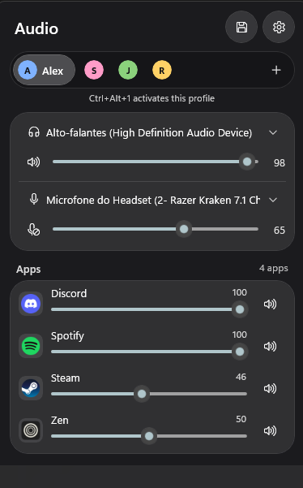
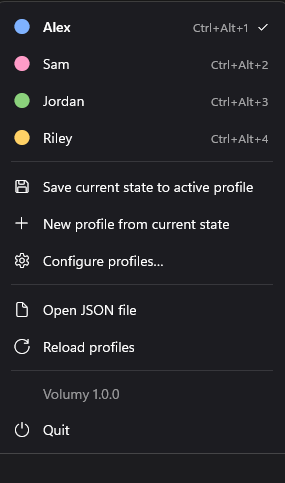
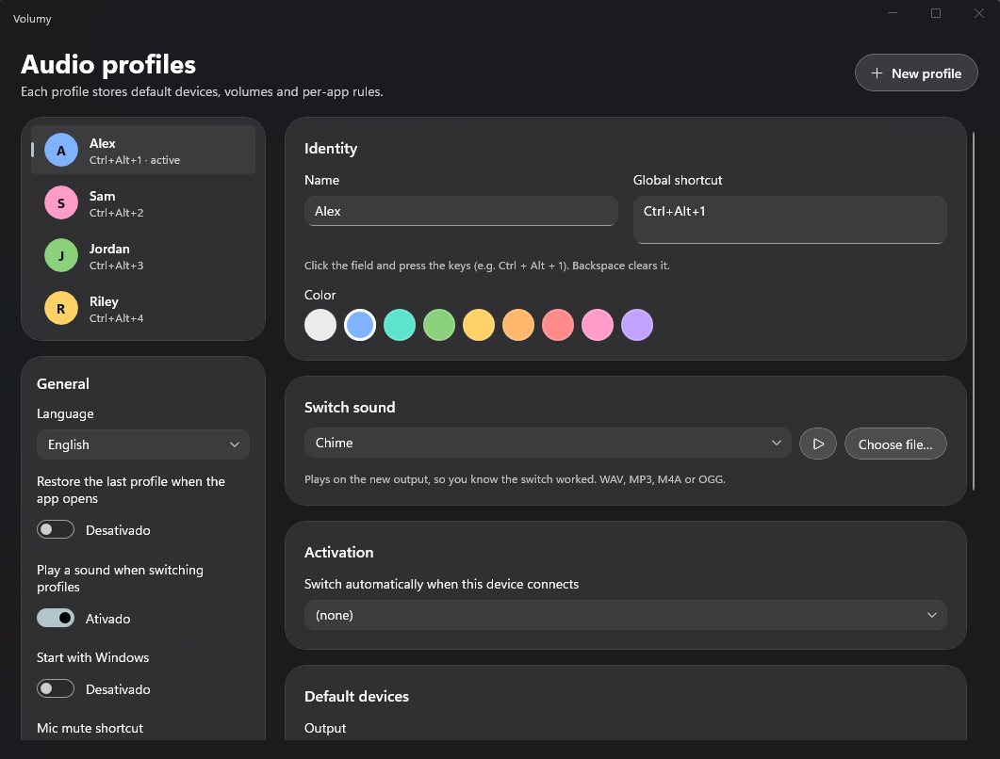

# Volumy

**Per-person audio profiles for Windows.** A tray app (in the spirit of EarTrumpet) for PCs shared by more than one person: each profile remembers its own output, microphone, volumes and per-app rules, and switching takes one click or one shortcut.

*Português (Brasil) abaixo.*

<p align="center">
  
  &nbsp;&nbsp;
  
</p>

<p align="center">
  
</p>

## Features

- **Glass tray flyout**: switch output and microphone, set volume and mute, with a live level meter.
- **Per-app mixer**: every app playing sound gets its own slider, tinted with its icon color.
- **Profiles**: name, color, global shortcut and switch sound for each person.
  - Switch from the flyout, the right-click menu or a shortcut (`Ctrl+Alt+1`, `Ctrl+Alt+2`…).
  - Switches automatically when a chosen device (e.g. a headset) is plugged in.
  - Volume changes you make in the flyout are saved to the active profile automatically, per app and per device.
  - Per-app volume rules are applied as soon as an app starts playing.
  - 8 built-in switch sounds, or use your own file.
- **Tray icon**: scroll to change volume, middle-click to mute; a red badge shows when the mic is muted.
- **Mic mute shortcut**, `Ctrl+Alt+M` by default.
- **Start with Windows**; English and Portuguese (Brazil).

## Install

1. Go to **[Releases](../../releases/latest)** and download **`Volumy-Setup-x.y.z.exe`**.
2. Run it. It installs for your user only, with no admin prompt. You don't need to install .NET.

Prefer no installer? Download the **portable zip**, extract it anywhere and run `Volumy.exe`.

**Updates:** Volumy checks GitHub for new versions. When there's one, it tells you, and **right-click the tray icon → Install update** downloads and installs it, then restarts the app. Your profiles are kept. (The portable version opens the download page instead.) You can turn the check off in **Configure profiles → General**.

> **"Windows protected your PC"**: the app isn't code-signed yet, so SmartScreen warns on first run. Click **More info → Run anyway**.

Requires Windows 10 1809 or later (x64). Built and tested on Windows 11.

## Build from source

You need **Visual Studio 2022+** with the **WinUI application development** workload, or just the **.NET 8 SDK**.

| Task | Command |
| --- | --- |
| Build and run | `run.cmd` |
| Installer + portable zip, locally | `publish.cmd 1.0.0` (the installer step needs [Inno Setup 6](https://jrsoftware.org/isinfo.php)) |
| Publish a GitHub release | `git tag v1.0.0 && git push origin v1.0.0` (GitHub Actions builds both files and creates the release) |

### Project layout

```
src/Volumy.Core   Audio (NAudio + IPolicyConfig), profiles, shortcuts, icon colors. No UI.
src/Volumy        WinUI 3 app: tray icon, flyout, menu, toast, profile editor
installer/        Inno Setup script
.github/workflows Build on every push; installer + zip on every version tag
```

### Screenshots

`demo.cmd` opens Volumy with sample profiles (Alex, Sam, Jordan, Riley) so your own profile names stay out of the images. See [docs/screenshots.md](docs/screenshots.md).

### Settings and logs

- Profiles: `%APPDATA%\Volumy\profiles.json` (kept when you uninstall).
- Logs next to `Volumy.exe`: `trace.log` (startup steps, recovered errors) and `crash.log` (unexpected errors).
- If the app closes unexpectedly, run `crashinfo.cmd` to collect Windows' crash report.

## Credits

The default-device switching follows the approach of [EarTrumpet](https://github.com/File-New-Project/EarTrumpet) (MIT). Tray icon: [H.NotifyIcon](https://github.com/HavenDV/H.NotifyIcon). Audio: [NAudio](https://github.com/naudio/NAudio).

---

## Português (Brasil)

**Perfis de áudio por pessoa para o Windows.** Cada perfil guarda a saída, o microfone, os volumes e as regras por app de quem usa o PC. Trocar de perfil leva um clique ou um atalho.

**Instalar:** baixe o **`Volumy-Setup-x.y.z.exe`** em **[Releases](../../releases/latest)** e execute. Não pede admin e não precisa instalar o .NET. Depois disso, o próprio app avisa quando sai uma versão nova: **clique com o botão direito no ícone da bandeja → Instalar atualização**. Se o Windows avisar "O Windows protegeu o computador", clique em **Mais informações → Executar assim mesmo** (o app ainda não tem assinatura digital).

O idioma do app pode ser trocado para português em **Configurar perfis → Geral → Idioma**.
